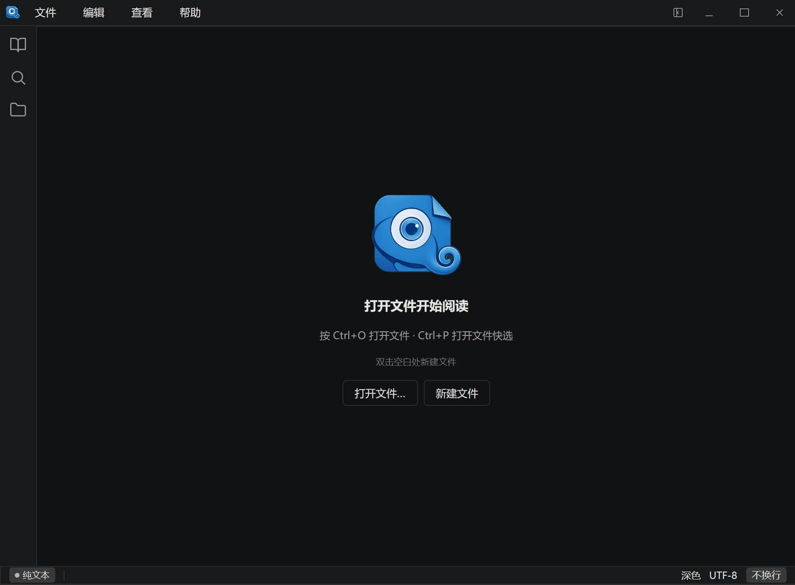
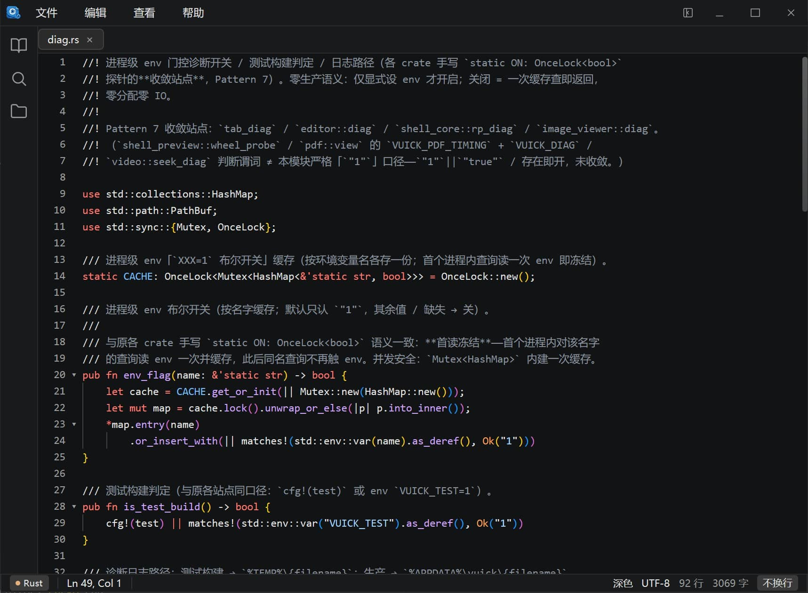
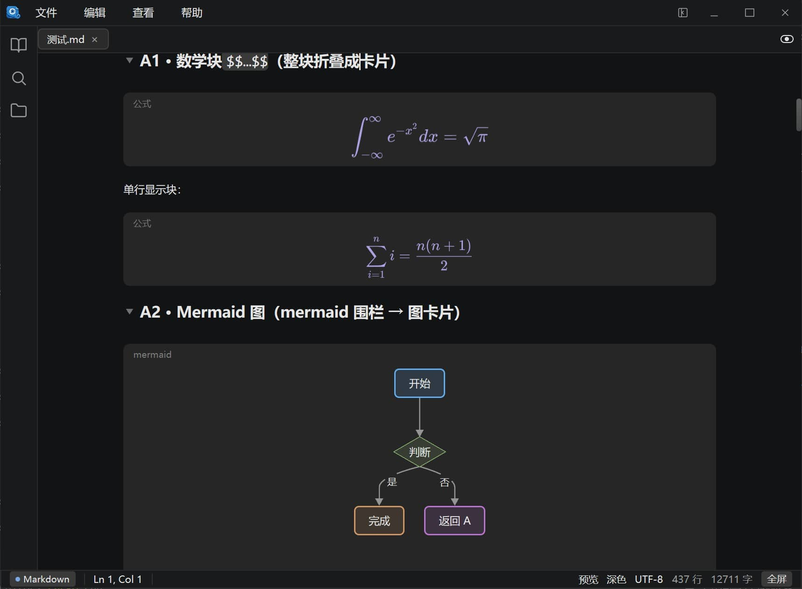
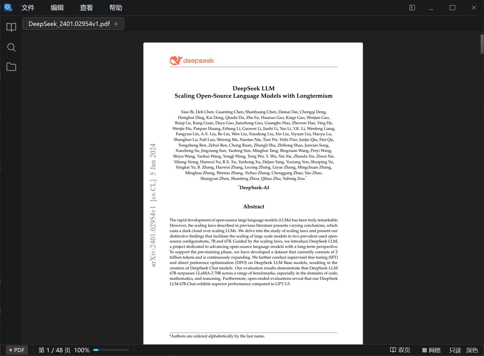
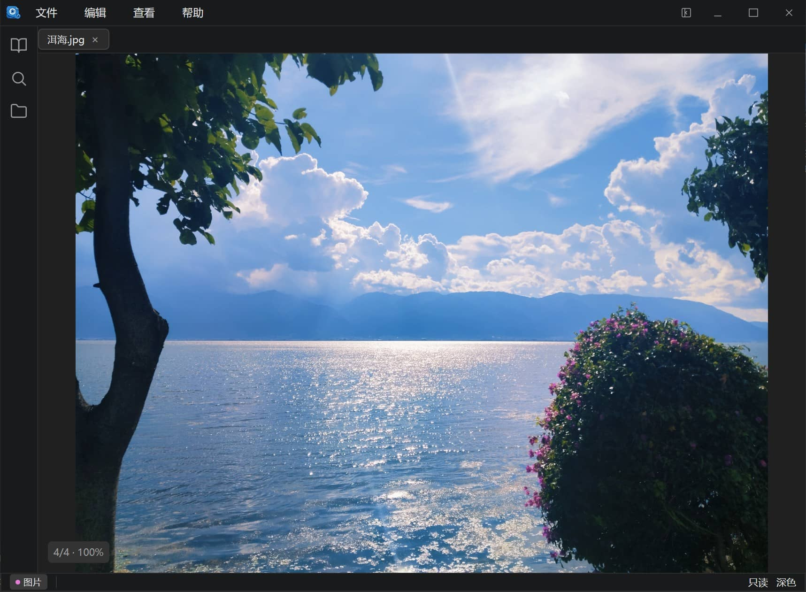
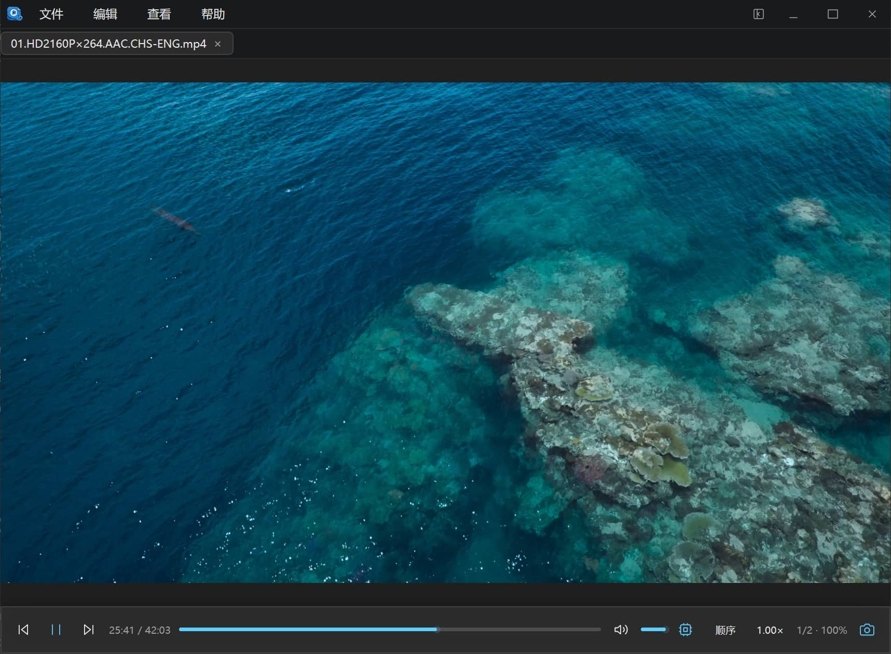
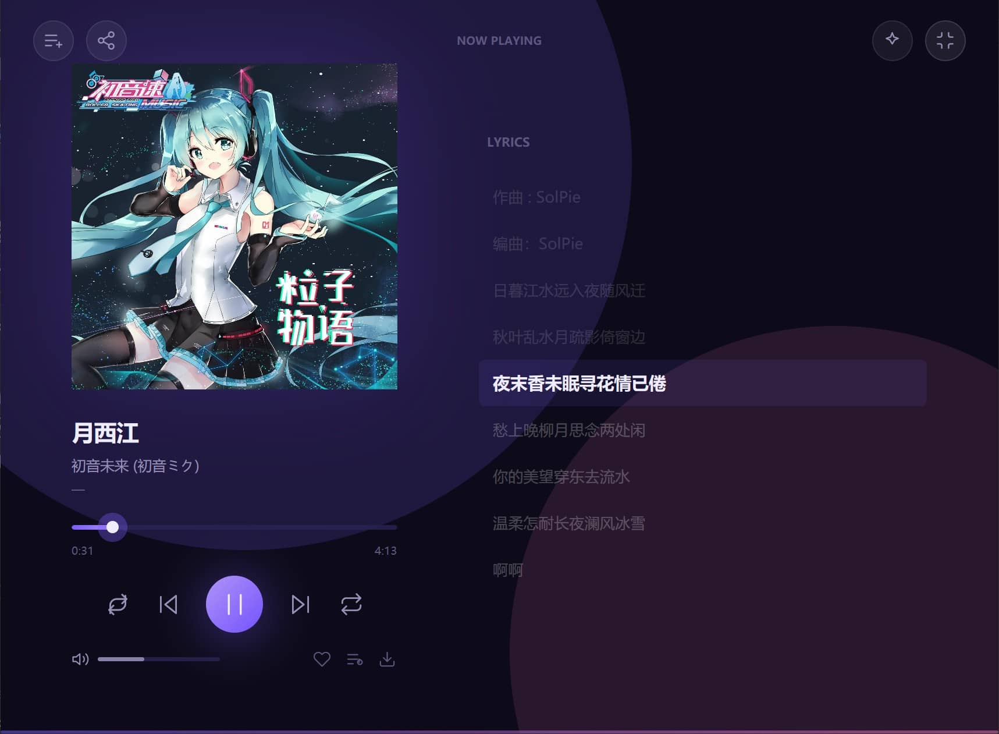

# Vuick

**[简体中文](README.md) ｜ English**


> A text / code / Markdown editor natively built with Rust + GPUI that also reads PDF & EPUB, views images, and plays video & music — no webview: fast, light, and fully offline.

<p align="center">
  
</p>

## ✨ Features

### Editing

- **Multi-file tabs**: new / open / drag-and-drop; closing an unsaved tab prompts a native confirmation dialog, so you never lose work by accident
- **Code editor**: syntax highlighting, line numbers, folding, selection, undo / redo; IME and UTF-16 cursor support keep CJK input and caret placement accurate
- **Encoding friendly**: `encoding_rs` handles non-UTF-8 files such as GBK / GB18030 / UTF-16 and writes back in the source encoding — legacy documents open without mojibake
- **Productivity**: command palette (`Ctrl+Shift+P`), workspace quick-open (`Ctrl+P`), in-editor find (`F3`), go-to-line (`Ctrl+G`, supporting `line:column`)
- **Status bar**: Ln / Col, word count, dirty marker, font-size adjustment

<p align="center">
  
</p>

### Markdown

- **Virtualized preview**: line-level windowed rendering decouples scroll cost from document size — hundred-thousand-line documents scroll just as smoothly
- **WYSIWYG live editing**: what you see is what you get; Mermaid vector diagrams + LaTeX / KaTeX math typesetting (ratex, pure CPU, fully offline)

<p align="center">
  
</p>

### Reader

- **PDF**: pdfium rasterization + viewport-tile virtualization so long documents render on demand without lag; a text layer enables full-document search
- **Video**: FFmpeg 9.0 decode & resample, 0.5–2× playback speed, pure-video locked mode, `Ctrl+wheel` zoom; FFmpeg is loaded dynamically at runtime (`media_ffmpeg.dll`) and its absence never blocks startup
- **EPUB**: HTML-typeset reading (roxmltree + zip) with footnote markers `[!N]`
- **Images**: the kimg image kernel decodes PNG / JPEG / WebP / GIF / BMP / ICO / PNM / TIFF
- **Music**: cpal output, local playback

<p align="center">
  
  
  
  
</p>

<details>
<summary>✨ More day-to-day details</summary>

- **Config persistence**: theme, font size, sidebar width, etc. are stored in `%APPDATA%\vuick\config.json` (overridable via the `VUICK_CONFIG` environment variable)
- **Session restore (on by default)**: unnamed tabs are restored as-is and the active tab is kept — no exit-hook dependency
- **Export / import settings**: config and session are packed into a self-validating `.json`; import takes effect immediately, with safety guards
- **Common shortcuts**: `Ctrl+N/O/W/S`, `Ctrl+P/Shift+P`, `Ctrl+F/G/M`, `Ctrl+=/-/0`, `Ctrl+Z/Y`, `Ctrl+Q` — the full table lives in [Keyboard Shortcuts](docs/shortcuts.md)

</details>

## 🚀 Getting It & Installing

> Not yet distributed from an official website — build from source; packaged artifacts can be produced with `scripts/package.ps1`.

```bash
# Dev run (set up the FFmpeg environment first)
pwsh scripts/setup-ffmpeg.ps1
cargo run

# Minimal run path that skips video (no FFmpeg needed)
cargo build --workspace --no-default-features --exclude media_ffmpeg
```

<details>
<summary>Full build, packaging & distribution (FFmpeg / pdfium / release artifacts)</summary>

- Release builds are configured with `opt-level=z` + LTO + `strip` + `panic=abort`; `pwsh scripts/package.ps1` produces `dist\vuick-win64\`
- PDF depends on the pdfium dynamic library; release can embed the dll into the exe when detected
- Testing: `cargo test` is fully green, fixtures are committed (shell suite ≈80s / 271 passed)
- Full environment setup, test fixtures, DLL manifest, and packaging details live in [Build, Packaging & Distribution](docs/build-packaging.md)

</details>

## 🧩 Tech Stack

Rust (edition 2024) · GPUI (vendored fork of the Zed repository, `vendor/zed`, native window, no webview) · ropey · syntect · pdfium-render · FFmpeg 9.0 / cpal · kimg (PNG/JPEG/WebP/GIF/BMP/ICO/PNM/TIFF decoding) · encoding_rs

## 📚 Documentation

| Doc | Contents |
| --- | --- |
| [User Manual](docs/manual.md) | User preferences, session restore, export / import settings, known limitations |
| [Architecture & Technology](docs/architecture.md) | Tech stack, UI component library, directory structure |
| [Build, Packaging & Distribution](docs/build-packaging.md) | Build environment, test fixtures, packaging, DLL manifest |
| [Keyboard Shortcuts](docs/shortcuts.md) | Full keybinding table |
| [License & Compliance](docs/licensing.md) | License and third-party compliance |

## 🤝 Contributing & Feedback

Is Vuick solving a real need for you, or would you like to help polish it? Send corrections and suggestions via [issue / PR](https://github.com/yuexiliuli/Vuick/issues) (contributing guide: [Contributing](https://github.com/yuexiliuli/Vuick/blob/master/README.md), or just discuss in [issues](https://github.com/yuexiliuli/Vuick/issues)), or edit this README directly.

## 📄 License

GPL-3.0-or-later (see `LICENSE-GPL`); compliance details for third-party components (embedded FFmpeg under LGPL loaded at runtime, pdfium, and the zorite-derived recognition layer) can be found in [License & Compliance](docs/licensing.md) and in the `THIRD_PARTY_NOTICES.md` shipped with the distribution.
