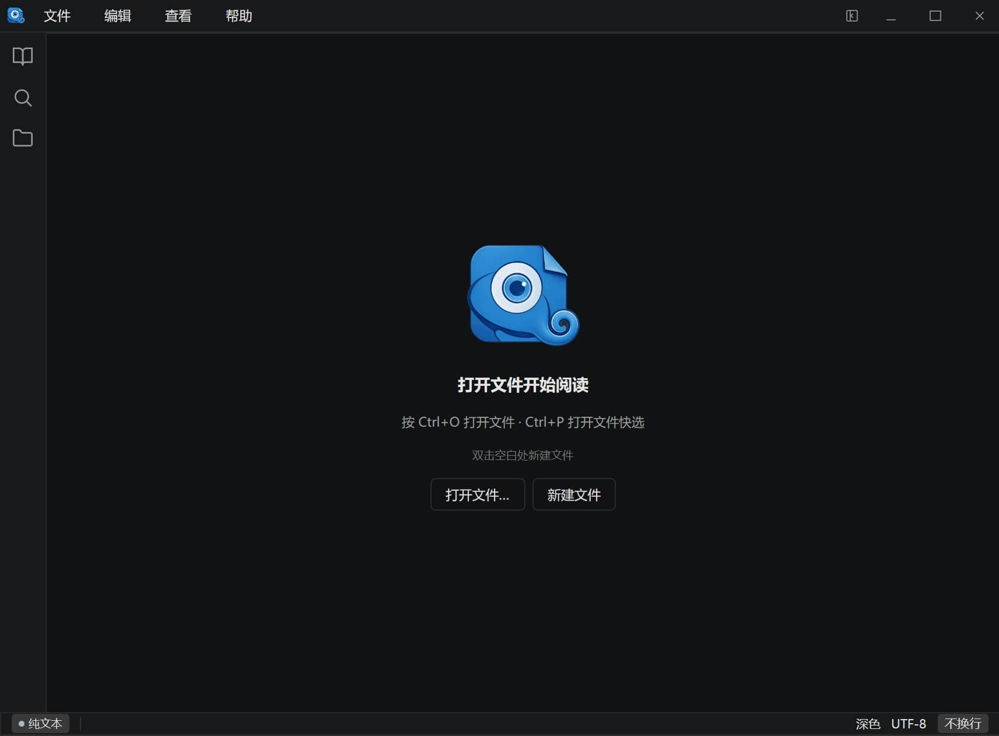
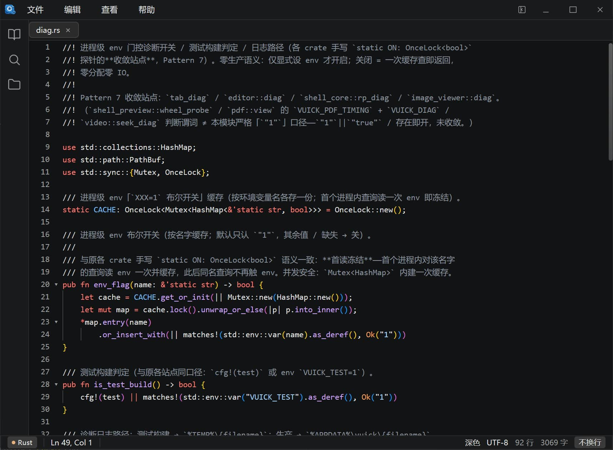
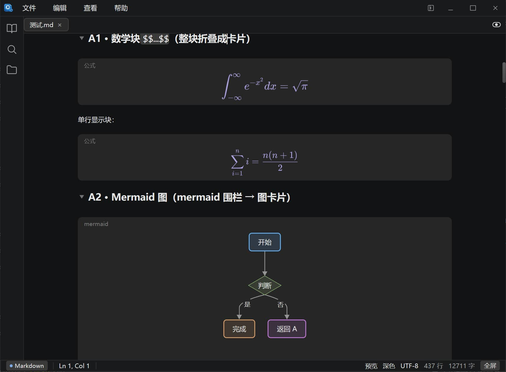
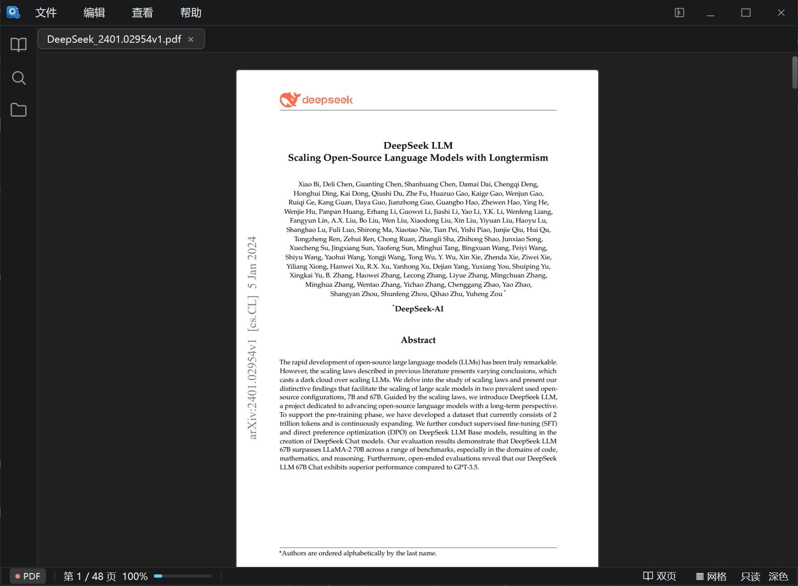
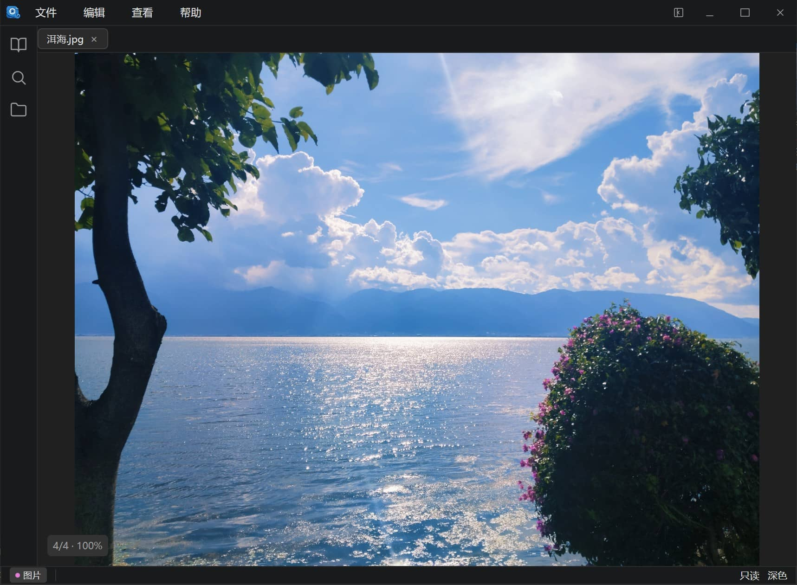
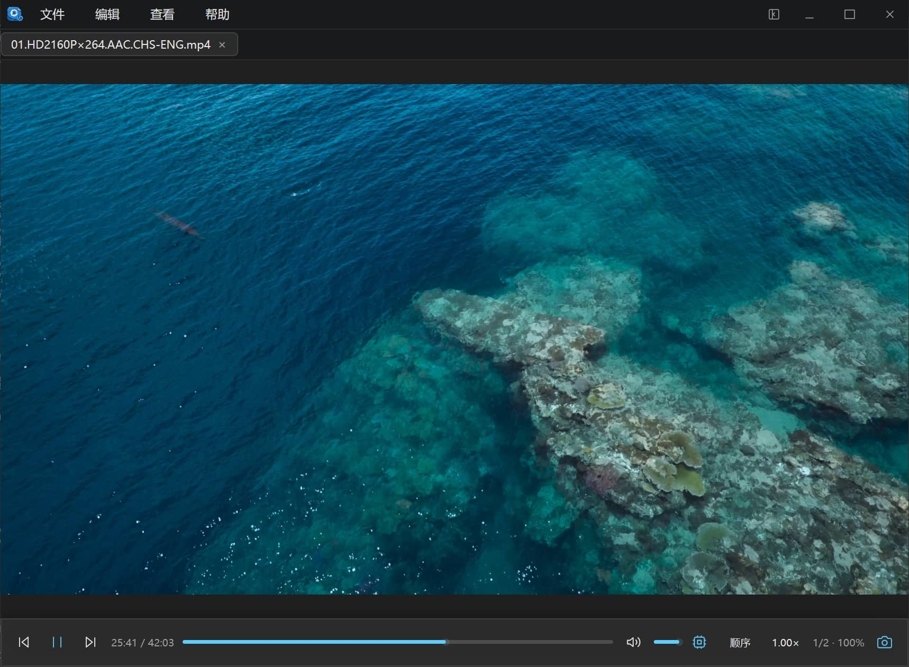
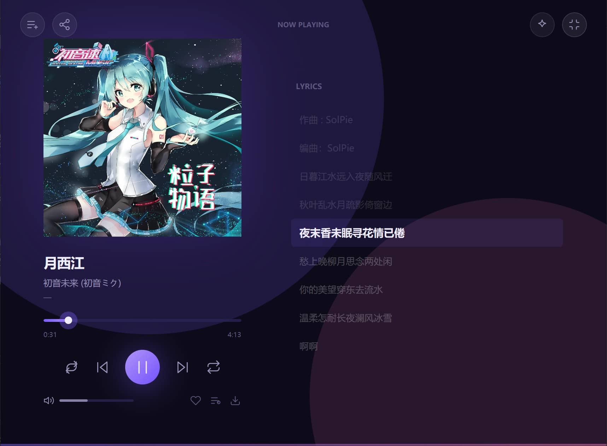

# Vuick

<!-- 徽章占位：CI / release / docs / 版本徽章，待仓库公开地址确定后填入，暂无 -->

> Rust + GPUI 原生构建的文本 / 代码 / Markdown 编辑器，兼可阅读 PDF / EPUB、浏览图片、播放视频与音乐——无 webview，快、轻、离线可用。

<p align="center">
  
</p>

## ✨ 特性

### 编辑

- **多文件选项卡**：新建 / 打开 / 拖放即开；关闭未保存的选项卡会弹原生确认框，误关不丢稿
- **代码编辑器**：语法高亮、行号、折叠、选择、撤销 / 重做；IME 与 UTF-16 光标让中文输入与定位准确不错位
- **编码友好**：`encoding_rs` 支持 GBK / GB18030 / UTF-16 等非 UTF-8 文件，编辑后按源编码回写——老文档、旧项目打开不乱码
- **效率**：命令面板（`Ctrl+Shift+P`）、工作区快速打开（`Ctrl+P`）、编辑区内查找（`F3`）、跳转到行（`Ctrl+G`，支持 `行:列`）
- **状态栏**：Ln / Col、字数、脏标记、字号调节

<p align="center">
  
</p>

### Markdown

- **虚拟化预览**：行级窗口化渲染，滚动开销与文档大小解耦——几万行的文档滚起来同样顺滑
- **WYSIWYG 实时编辑**：所见即所得；Mermaid 矢量图 + LaTeX / KaTeX 数学排版（ratex，纯 CPU，离线可用）

<p align="center">
  
</p>

### 阅读器

- **PDF**：pdfium 栅格化 + 视口瓦片虚拟化，长文档按需渲染不卡顿；叠加文本层，支持全文档搜索
- **视频**：FFmpeg 9.0 解码与重采样、倍速 0.5–2×、纯视频锁定模式、`Ctrl+滚轮` 缩放；FFmpeg 经运行时动态加载（`media_ffmpeg.dll`），缺库不影响启动
- **EPUB**：HTML 排版阅读（roxmltree + zip），脚注标记 `[!N]`
- **图片**：kimg 图像内核，PNG / JPEG / WebP / GIF / BMP / ICO / PNM / TIFF 解码
- **音乐**：cpal 输出，本地播放

<p align="center">
  
  
  
  
</p>

<details>
<summary>✨ 更多日常细节</summary>

- **配置持久化**：主题、字号、侧栏宽等写入 `%APPDATA%\vuick\config.json`（可用 `VUICK_CONFIG` 环境变量覆盖路径）
- **会话恢复（默认开启）**：未命名选项卡原样恢复、活动 tab 保持，不依赖退出钩子
- **导出 / 导入设置**：配置与会话打包为自校验 `.json`，导入即时生效，带安全防护
- **常用快捷键**：`Ctrl+N/O/W/S`、`Ctrl+P/Shift+P`、`Ctrl+F/G/M`、`Ctrl+=/-/0`、`Ctrl+Z/Y`、`Ctrl+Q`——完整键位见 [快捷键](docs/shortcuts.md)

</details>

## 🚀 获取与安装

> 目前未经官网分发，请从源码构建；已打包产物可用 `scripts/package.ps1` 生成。

```bash
# 开发运行（需先配 FFmpeg 环境）
pwsh scripts/setup-ffmpeg.ps1
cargo run

# 跳过视频功能的最小跑通路径（无需 FFmpeg）
cargo build --workspace --no-default-features --exclude media_ffmpeg
```

<details>
<summary>完整构建、打包与分发（FFmpeg / pdfium / 发布 artifact）</summary>

- 发布构建已配 `opt-level=z` + LTO + `strip` + `panic=abort`；`pwsh scripts/package.ps1` 产出 `dist\vuick-win64\`
- PDF 依赖 pdfium 动态库；release 探测到 dll 时可内嵌进 exe
- 测试：`cargo test` 全量绿，fixtures 已入库（shell 全量 ≈80s / 271 passed）
- 完整环境配置、测试 fixture、DLL 清单与打包细节见 [构建、打包与分发](docs/build-packaging.md)

</details>

## 🧩 技术栈

Rust（edition 2024）· GPUI（Zed 仓库 vendored fork，`vendor/zed`，原生窗口，无 webview）· ropey · syntect · pdfium-render · FFmpeg 9.0 / cpal · kimg（PNG/JPEG/WebP/GIF/BMP/ICO/PNM/TIFF 解码）· encoding_rs

## 📚 文档

| 文档 | 内容 |
| --- | --- |
| [使用手册](docs/manual.md) | 用户偏好、会话恢复、导出 / 导入设置、已知限制 |
| [架构与技术](docs/architecture.md) | 技术栈、UI 组件库、目录结构 |
| [构建、打包与分发](docs/build-packaging.md) | 构建环境、测试 fixture、打包、DLL 清单 |
| [快捷键](docs/shortcuts.md) | 全部键位表 |
| [许可证与合规](docs/licensing.md) | 许可证与第三方合规 |

## 🤝 贡献与反馈

有这样的编辑器是你的刚需，还是想帮忙打磨它？欢迎以 [issue / PR](#) 提交纠错与建议（贡献指南见 [Contributing](#)），或直接修正本 README。

## 📄 许可

GPL-3.0-or-later（见 `LICENSE-GPL-3.0`）；第三方组件（内置 FFmpeg 的 LGPL 运行时动态加载、pdfium、zorite 衍生识别层等）合规说明见 [许可证与合规](docs/licensing.md) 与发行包内 `THIRD_PARTY_NOTICES.md`。
